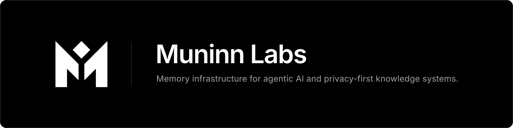

  

<h3 align="center">Memory infrastructure for agentic AI and privacy-first knowledge systems.</h3>

  <a href="https://github.com/muninn-hq">Repositories</a> ·
  <a href="https://github.com/muninn-hq/.github/blob/main/CONTRIBUTING.md">Contributing</a> ·
  <a href="https://github.com/muninn-hq/.github/blob/main/SECURITY.md">Security</a>

---

## About

**Muninn Labs** builds open-source memory, sync, and knowledge infrastructure for AI agents and privacy-conscious teams.

## Projects

| Repository | Stack | Description |
|---|---|---|
| [`aether-sdk`](https://github.com/muninn-hq/aether-sdk) | Rust | An AI Memory Layer for Modern Agentic AI |
| [`aether-memory`](https://github.com/muninn-hq/aether-memory) | TypeScript | Privacy-preserving two-way vault sync, Git lattice sync, and KV-cache warming for Aether MCP |
| [`brand`](https://github.com/muninn-hq/brand) | SVG / Docs | Logos, color palette, and visual assets |

## Engineering Principles

- **Local-first & privacy-preserving** — user data stays under user control.
- **Strict boundaries** — explicit schemas, typed interfaces, and minimal surface area.
- **Verified by default** — deterministic tests and CI checks on every change.

## Contributing

Read our [Contributing Guide](https://github.com/muninn-hq/.github/blob/main/CONTRIBUTING.md) and [Code of Conduct](https://github.com/muninn-hq/.github/blob/main/CODE_OF_CONDUCT.md) before opening a pull request.
